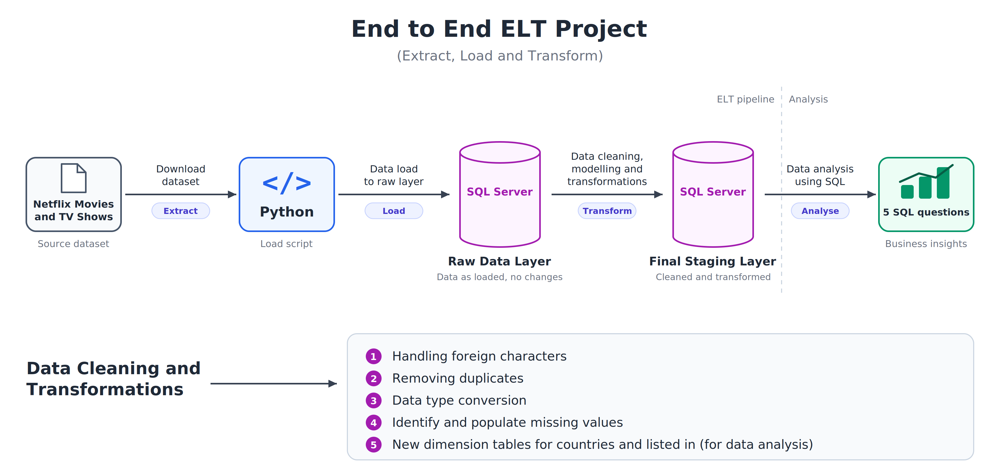

# ELT-Project-Netflix-Movies-and-TV-Shows

An end to end **ELT (Extract, Load, Transform)** pipeline built with **Python** and **SQL Server**. The Netflix Movies and TV Shows dataset is loaded as-is into a raw layer, then cleaned, modelled and transformed inside SQL Server into a final staging layer, and finally analysed with SQL to answer 5 business questions.

---

## Architecture


## Pipeline Steps

| Step | Stage | What happens |
|---|---|---|
| 1 | **Extract** | The Netflix Movies and TV Shows dataset is downloaded. |
| 2 | **Load** | Python loads the data into the **Raw Data Layer** in SQL Server. |
| 3 | **Transform** | Data cleaning, modelling and transformations are done in SQL Server to build the **Final Staging Layer**. |
| 4 | **Analyse** | SQL queries on the final layer answer 5 business questions. |

**Why ELT?** The raw data is loaded first without changes, so the original data is always preserved. All cleaning and transformation then happens inside the database using SQL.

---

## Data Cleaning and Transformations

1. **Handling foreign characters**: fixed titles and names that contained non-English characters.
2. **Removing duplicates**: identified and removed duplicate records.
3. **Data type conversion**: converted columns to the correct data types.
4. **Identifying and populating missing values**: found missing values and filled them.
5. **New dimension tables**: created new dimension tables for **countries** and **listed in** (genres) to support analysis.

---

## Data Layers

| Layer | Purpose |
|---|---|
| **Raw Data Layer** | Data exactly as loaded from the source, no changes. |
| **Final Staging Layer** | Cleaned, modelled and transformed data, ready for analysis. |

---

## Business Questions Answered

Analysis was done in SQL on the final staging layer to answer 5 questions:

1. [Add question 1]
2. [Add question 2]
3. [Add question 3]
4. [Add question 4]
5. [Add question 5]

---

## Tech Stack

- **Python**: downloading and loading the data into SQL Server
- **SQL Server and T-SQL**: raw layer, staging layer, cleaning, transformations and analysis

---

## Project Structure

> Edit this to match your repository.

```
├── python/          # script to load data into the raw layer
├── sql/             # cleaning, transformation and analysis scripts
├── architecture.png # architecture diagram
└── README.md
```

---

## How to Run

> Edit these steps to match your setup.

1. Download the Netflix Movies and TV Shows dataset.
2. Run the Python script to load the data into the raw layer in SQL Server.
3. Run the SQL scripts to clean and transform the data into the final staging layer.
4. Run the analysis queries to get the answers.

---

## What I Learned

- Building an end to end ELT pipeline with a raw layer and a final staging layer
- Cleaning real-world data in SQL (duplicates, missing values, data types, foreign characters)
- Creating dimension tables to make analysis easier
- Writing SQL queries to answer business questions

